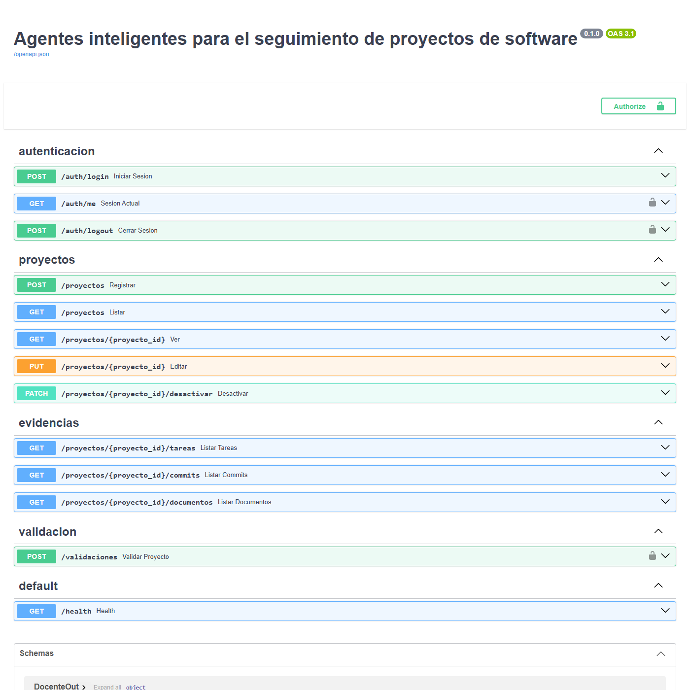
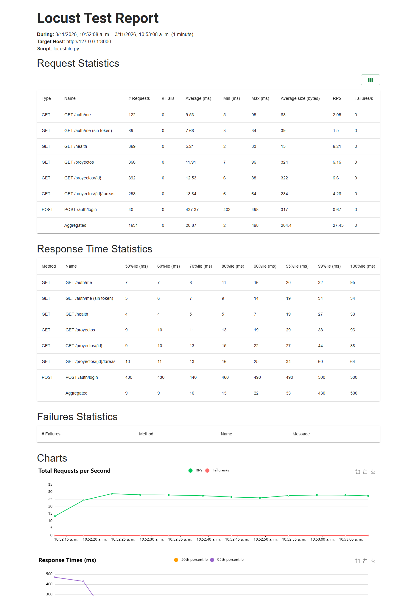
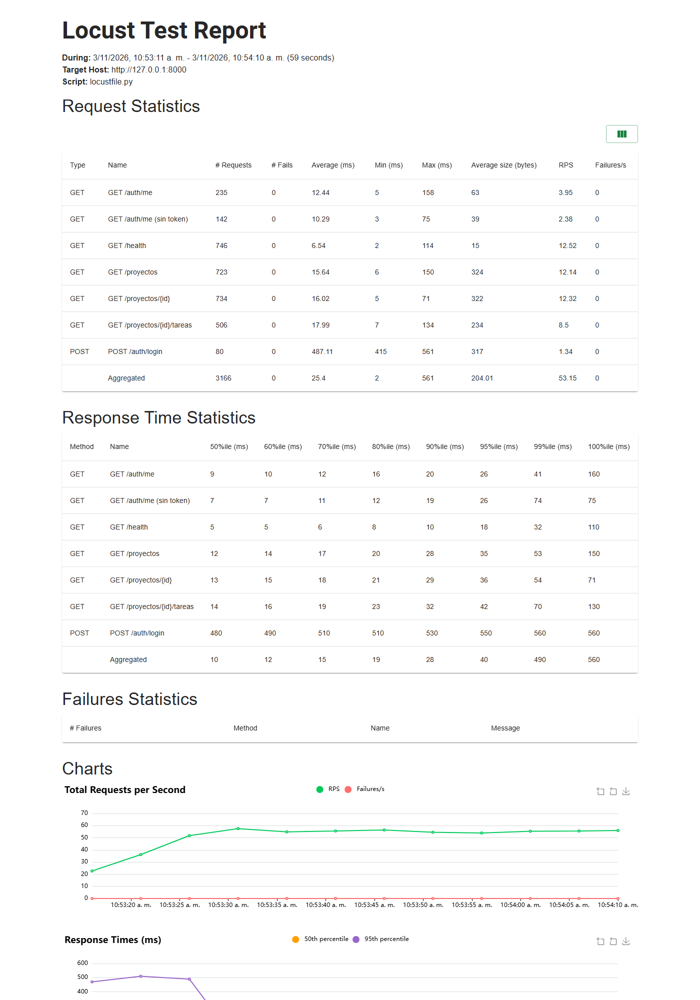
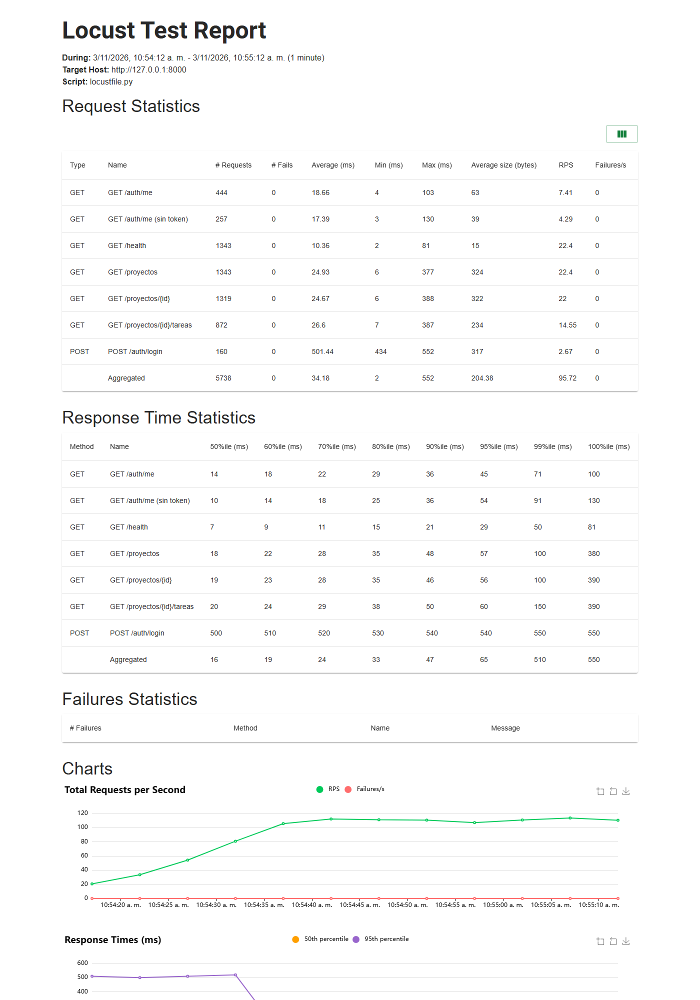

# Pruebas de carga y disponibilidad (Locust)

Atributos de calidad cubiertos: **rendimiento** y **disponibilidad**. Herramienta: [Locust](https://locust.io/) 2.32.4.

## 1. Qué se hizo

1. **Revisión del proyecto.** Se identificaron los endpoints expuestos por FastAPI (visibles en Swagger, `/docs`) y se vio que Playwright (`e2e/`) y la CI (`ci.yml`, `e2e.yml`) ya existían.
2. **Script de carga** [`pruebas_carga/locustfile.py`](../../pruebas_carga/locustfile.py) con dos tipos de usuario:
   - *Visitante anónimo* (peso 1): `GET /health` y `GET /auth/me` sin token. Un 401 cuenta como éxito; un 5xx, como fallo.
   - *Docente en sesión* (peso 4): `POST /auth/login` una vez y luego `GET /proyectos`, `GET /proyectos/{id}`, `GET /proyectos/{id}/tareas` y `GET /auth/me`.
   - Umbrales: la corrida falla (código de salida 1) si hay más de 1 % de errores o el p95 supera 1500 ms.
3. **Workflow manual** [`.github/workflows/carga.yml`](../../.github/workflows/carga.yml): pide URL, usuarios (50/100/200) y duración; sube el informe como artefacto. Los parámetros entran por variables de entorno, no interpolados en el comando.
4. **Instalación de Locust** en un entorno virtual (`venv_carga`) junto con las dependencias del backend. Quedó fijado en `pruebas_carga/requirements.txt`.
5. **Entorno de ensayo local.** No había PostgreSQL ni Docker en la máquina, así que se creó [`pruebas_carga/arrancar_local_sqlite.py`](../../pruebas_carga/arrancar_local_sqlite.py): levanta la API real con SQLite, crea las tablas, siembra un docente de prueba y registra la función `btrim` que el modelo usa en un CHECK de PostgreSQL.
6. **Datos de prueba.** Se registró un proyecto por `POST /proyectos` (201) para que las consultas devolvieran datos.
7. **Tres corridas** de 60 s con 50, 100 y 200 usuarios simultáneos (spawn rate 10/s), todas con el mismo script.
8. **Capturas** de los informes de Locust y de Swagger con Edge en modo headless.

## 2. Endpoints probados (Swagger)



`POST /validaciones` no se probó a propósito: dispara GitHub Actions y gastaría cuota real.

## 3. Resultados

Cifras tomadas de los CSV de Locust (`evidencias/carga_*_stats.csv`). Los informes HTML pueden diferir en unas pocas peticiones por el momento del cierre.

| Usuarios | Peticiones | Fallos | Req/s | Mediana (ms) | p95 (ms) | p99 (ms) | Umbrales |
|---:|---:|---:|---:|---:|---:|---:|---|
| 50 | 1 631 | 0 (0 %) | 27,5 | 9 | 33 | 430 | OK |
| 100 | 3 156 | 0 (0 %) | 53,2 | 10 | 40 | 490 | OK |
| 200 | 5 712 | 0 (0 %) | 96,2 | 16 | 65 | 510 | OK |

Detalle por endpoint (p95 en ms):

| Endpoint | 50 usuarios | 100 usuarios | 200 usuarios |
|---|---:|---:|---:|
| `GET /health` | 19 | 18 | 29 |
| `GET /auth/me` (sin token, 401 esperado) | 19 | 26 | 54 |
| `GET /auth/me` | 20 | 26 | 45 |
| `GET /proyectos` | 29 | 35 | 57 |
| `GET /proyectos/{id}` | 27 | 36 | 55 |
| `GET /proyectos/{id}/tareas` | 34 | 42 | 59 |
| `POST /auth/login` | 490 | 550 | 540 |

### Capturas de los informes

**50 usuarios**



**100 usuarios**



**200 usuarios**



Los informes completos (con todas las gráficas) están en `evidencias/informe_50.html`, `informe_100.html` e `informe_200.html`; los datos crudos, en los CSV.

## 4. Lectura de los resultados

- **Disponibilidad:** 0 fallos en las tres corridas. El rendimiento escala de forma casi lineal (27 → 53 → 96 req/s) y el p95 sube poco (33 → 65 ms).
- **Punto más lento: `POST /auth/login`** (~430–560 ms). Es esperable, porque verifica la contraseña con bcrypt, que es costoso a propósito. No degrada con más usuarios porque cada usuario inicia sesión una sola vez.
- **Rutas protegidas sin token** responden 401 de forma estable bajo carga, sin 5xx.
- El p99 agregado (430–510 ms) lo explica el login, no las consultas.

## 5. Limitaciones (importante)

- **No es una medición de producción.** La base fue **SQLite local**, un solo proceso de uvicorn, cliente y servidor en la misma máquina. Con PostgreSQL en Neon la latencia será mayor y debe repetirse la prueba contra el entorno desplegado (el workflow `carga.yml` sirve para eso).
- **`/proyectos/{id}/tareas` midió la ruta degradada.** No había token de Notion, así que respondió 200 con `estado: "fallo"` y 0 tareas, sin llamar de verdad a Notion. Con credenciales reales esa ruta será más lenta.
- **Las rutas `/proyectos` no piden token.** Usan un `docente_actual` temporal que devuelve siempre el docente 1 (está comentado en el código). Es un hallazgo de seguridad para quien lleve esa parte.
- Las credenciales del docente de prueba son ficticias y viven solo en el script de ensayo local; no hay credenciales reales en el repositorio.

## 6. Cómo repetirlo

```bash
python -m venv venv_carga && venv_carga/Scripts/pip install -r pruebas_carga/requirements.txt -r backend/requirements.txt
python pruebas_carga/arrancar_local_sqlite.py          # terminal 1: API local con SQLite
export CARGA_CORREO=carga@prueba.local CARGA_PASSWORD=<la del script> CARGA_PROYECTO_ID=1
locust -f pruebas_carga/locustfile.py --headless --host http://127.0.0.1:8000 \
  --users 100 --spawn-rate 10 --run-time 60s --csv docs/carga/evidencias/carga_100 --html docs/carga/evidencias/informe_100.html
```

Antes de la primera corrida hay que registrar un proyecto con `POST /proyectos` (el ejemplo está en Swagger).

## 7. Repetición con PostgreSQL 18 local

Las tres corridas se repitieron con la API sobre PostgreSQL 18 (migración Alembic 0001 aplicada sin errores). Datos en `evidencias_postgres/`.

| Usuarios | Peticiones | Fallos | Req/s | Mediana (ms) | p95 (ms) | p99 (ms) |
|---:|---:|---:|---:|---:|---:|---:|
| 50 | 1 631 | 0 | 27,7 | 15 | 42 | 710 |
| 100 | 3 131 | 0 | 52,6 | 20 | 78 | 730 |
| 200 | 5 622 | 0 | 93,9 | 42 | 250 | 790 |

Con PostgreSQL la latencia es mayor que con SQLite (p95 a 200 usuarios: 250 ms frente a 65 ms) y las consultas a la base pasan de ~55 ms a 220–240 ms, sin fallos y bajo el umbral de 1500 ms. Sigue siendo un solo proceso con cliente y servidor en la misma máquina, y se usó la versión 18 (el README pide la 16). Detalle completo en el documento Word `Pruebas_de_Carga_y_Disponibilidad_Locust.docx`.
