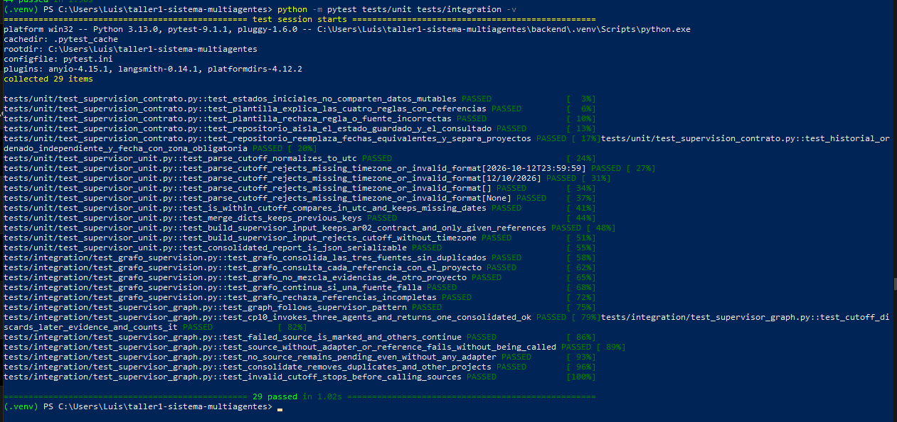
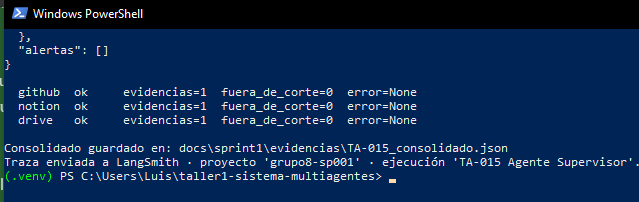
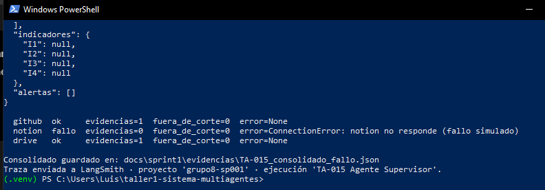
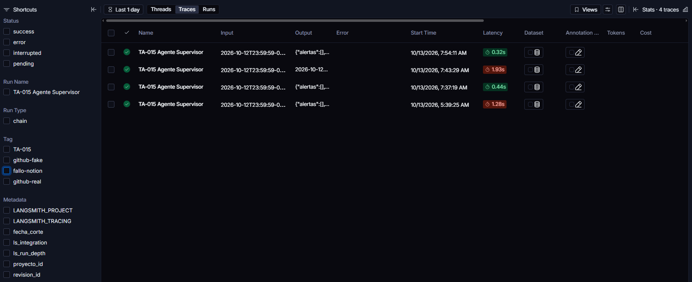

# TA-015 · Agente Supervisor

| Campo | Valor |
|---|---|
| PBI | TA-015 · Tarea · EP-02 · Sprint 1 · semana 7 (12/10 – 16/10/2026) |
| Responsable (R) | Reyes |
| Verificador (A) | Castro (Scrum Master de la semana 7) |
| Estimación | 2,25 SP · 9 h |
| Horas reales | 7 h (ver la sección 9) |
| Rama | `reyes/ta-015-agente-supervisor` |
| Pull Request | #16 (merge a cargo de Castro) |
| Especificación | [docs/specs/TA-015.md](../specs/TA-015.md) |

## 1. Objetivo

Convertí la POC secuencial de TA-012 en el Agente Supervisor definitivo. El agente recibe un proyecto y una fecha de corte, invoca a los Agentes GitHub, Notion y Drive, y entrega un consolidado por proyecto con el estado `ok` o `fallo` de cada fuente, trazado en LangSmith.

## 2. Organicé el trabajo por checkpoints

Partí de `main` actualizado (`5b8c067`, con mi PR #14 de correcciones de las semanas 5 y 6) y trabajé en una rama exclusiva, con un commit por etapa:

| Checkpoint | Qué hice | Commit |
|---|---|---|
| 1 | Comprobé la línea base antes de programar: `26 passed` | — |
| 2 | Escribí la spec y documenté el patrón de orquestación | `fcd710f` |
| 3 | Implementé el supervisor y el script de ejecución | `9fc4f55` |
| 4 | Separé las pruebas por tipo y agregué las de TA-015 | `a0eeec1` |
| 5 | Ejecuté los 3 escenarios con traza y registré las evidencias | `7f34599` |

## 3. Escribí la spec antes del código

Siguiendo la indicación del docente en la reunión del 08/10, primero redacté [la spec de TA-015](../specs/TA-015.md) con el propósito, el alcance, el patrón de orquestación, las entradas y salidas, y 8 reglas de comportamiento. Después programé contra esa spec.

Al revisarla corregí una incoherencia: había escrito el estado de las fuentes como `failed`, pero el contrato AR-02 (`EstadoFuente`) y el backlog usan `pendiente / ok / fallo`. La dejé en `fallo`.

## 4. Elegí y documenté el patrón de orquestación

El docente pidió dejar claro qué patrón de orquestación usamos. Elegí el **patrón supervisor (jerárquico)** y lo documenté en la sección 5.1 de [arquitectura.md](../arquitectura.md), comparándolo con swarm, mesh y pipeline.

```
START → supervisor → github_agent ┐
                   → notion_agent ├→ consolidate → END
                   → drive_agent  ┘   (en paralelo, con Send)
```

La POC de TA-012 recorría las fuentes en secuencia (un pipeline). En TA-015 el supervisor envía un encargo a cada agente con `Send`, y los tres se ejecutan **en el mismo paso**. Lo comprobé con el modo `debug` de LangGraph:

```
1 supervisor
2 github_agent
2 notion_agent
2 drive_agent
3 consolidate
```

## 5. Implementación

Creé `backend/app/modulos/supervision/grafo/supervisor.py`, organizado en bloques comentados (A–K):

| Elemento | Qué hace |
|---|---|
| `build_supervisor_input(project_id, cutoff, references)` | Arma la entrada a partir de `crear_estado_inicial` (AR-02) y valida la fecha de corte |
| `build_supervisor_graph(adapters)` | Construye el grafo con **un adaptador por fuente**, inyectado por el puerto `FuenteEvidencia` (AR-01) |
| Nodo `supervisor` | Valida la fecha de corte (ISO 8601 con zona horaria) y marca en `fallo` las fuentes sin adaptador o sin referencia |
| Nodos `github_agent`, `notion_agent`, `drive_agent` | Consultan su adaptador, conservan solo evidencias de su fuente y proyecto, y descartan las posteriores al corte. Si el adaptador falla, la fuente queda en `fallo` y las demás continúan |
| Nodo `consolidate` | Elimina duplicados por `(fuente, id_externo)` y ordena por fecha |
| `to_consolidated_report(state)` | Entrega el consolidado por proyecto en JSON |

También creé `backend/scripts/run_supervisor.py` (bloques 1–7), que ejecuta el grafo, guarda el consolidado y envía la traza a LangSmith, y actualicé el README del módulo.

Decisiones que tomé:

- **Mantuve el contrato AR-02.** El estado final conserva las claves de `EstadoSupervision`. Las claves internas que los agentes escriben en paralelo (`raw_evidence` y `source_details`) usan reductores de LangGraph para que las tres ramas no se pisen.
- **Un adaptador por fuente.** GitHub puede usar el adaptador real de Chávez (TA-006); Notion y Drive usan `FuenteEvidenciaFalsa` hasta que existan TA-007 (semana 8) y TA-014 (semana 9). Al conectar los reales no cambia el supervisor.
- **Código nuevo en inglés**, con comentarios, docstrings y mensajes en español, como pidió el docente. No renombré los contratos existentes porque afectan a los 4 módulos; propongo decidirlo en equipo.
- Conservé `construir_grafo.py` (TA-012) como evidencia de la semana 6.

## 6. Pruebas

Separé las pruebas por tipo, como pidió el docente, y moví con `git mv` mis pruebas anteriores para conservar su historial:

| Carpeta | Archivo | Pruebas |
|---|---|---:|
| `tests/unit/` | `test_supervisor_unit.py` (TA-015) | 10 |
| `tests/unit/` | `test_supervision_contrato.py` (AR-02, movido) | 6 |
| `tests/integration/` | `test_supervisor_graph.py` (TA-015) | 8 |
| `tests/integration/` | `test_grafo_supervision.py` (TA-012, movido) | 5 |

Las pruebas de integración de TA-015 comprueban el patrón supervisor, **CP-10** (3 agentes invocados una vez cada uno con su referencia y 1 consolidado con las 3 fuentes en `ok`), el descarte por fecha de corte, la continuidad cuando una fuente cae, las fuentes sin adaptador o sin referencia, que ninguna fuente quede en `pendiente`, la eliminación de duplicados y el rechazo de una fecha sin zona horaria.

| Ejecución | Resultado observado |
|---|---|
| `python -m pytest tests/unit -v` | 16 passed |
| `python -m pytest tests/integration -v` | 13 passed |
| `python -m pytest tests/unit tests/integration -v` | **29 passed** |
| `python -m pytest -q` (proyecto completo) | **44 passed** |



## 7. Ejecución y traza en LangSmith

Con `LANGSMITH_TRACING=true` y mi clave en el `.env` local (fecha de corte `2026-10-12T23:59:59-05:00`) ejecuté tres escenarios:

| Escenario | Resultado observado | Evidencia |
|---|---|---|
| 3 fuentes con datos demo | github ok · notion ok · drive ok | [TA-015_consolidado.json](evidencias/TA-015_consolidado.json) |
| GitHub real (adaptador TA-006) sobre `jhon1212-beep/taller1-sistema-multiagentes` | github ok · evidencias=18 · fuera_de_corte=2 | [TA-015_consolidado_github_real.json](evidencias/TA-015_consolidado_github_real.json) |
| Notion caído (simulado) | github ok · **notion fallo** (`ConnectionError`) · drive ok | [TA-015_consolidado_fallo.json](evidencias/TA-015_consolidado_fallo.json) |

En el escenario con GitHub real, obtuve **18 evidencias válidas y 2 evidencias fuera de la fecha de corte**. Notion y Drive aportaron una evidencia cada uno, por lo que el consolidado final tuvo **20 evidencias**. Los commits del 13/10 posteriores al corte quedaron fuera del consolidado y se contabilizaron en `fuera_de_corte`, lo que demuestra la regla 3 con datos reales.

También verifiqué que el archivo JSON generado no contuviera referencias a `token`, `authorization` ni `api_key`.





En LangSmith (proyecto `grupo8-sp001`) verifiqué las ejecuciones **"TA-015 Agente Supervisor"** con los nodos `supervisor`, `github_agent`, `notion_agent`, `drive_agent` y `consolidate`, y la etiqueta `TA-015`.



La clave de LangSmith y el `GITHUB_TOKEN` permanecen solo en mi `.env` local, que está excluido por `.gitignore`.

## 8. Criterios de aceptación

| N.° | Criterio | Estado | Evidencia |
|---|---|---|---|
| 1 | Invoca los Agentes GitHub, Notion y Drive con una fecha de corte | Cumple | Prueba CP-10, modo debug (paso 2) y traza |
| 2 | Entrega 1 consolidado por proyecto con estado ok/fallo por fuente (CP-10) | Cumple | `TA-015_consolidado.json` y `TA-015_consolidado_fallo.json` |
| 3 | Cada ejecución queda trazada en LangSmith | Cumple | `TA-015_traza_langsmith.png` |

**Límite declarado:** Notion y Drive todavía usan la fuente falsa. CP-10 con las 3 fuentes **reales** corresponde a TA-037 (semana 10), cuando se conecten TA-007 y TA-014.

## 9. Tiempo dedicado

| Actividad | Horas reales |
|---|---:|
| Checkpoint 1: rama, entorno y línea base | 0,4 |
| Checkpoint 2: spec, patrón de orquestación y correcciones | 0,8 |
| Checkpoint 3: supervisor, script, README y smoke test | 1,5 |
| Checkpoint 4: reorganización y pruebas unitarias e integración | 1,0 |
| Checkpoint 5: escenarios, trazas, evidencias y Pull Request | 3,3 |
| **Total** | **7,0 h** (estimado: 9 h) |

## 10. Errores y aprendizajes

| Error | Causa | Solución |
|---|---|---|
| El diff de `arquitectura.md` mostraba cambios en líneas que no edité | El Bloc de notas cambió el fin de línea (LF → CRLF) de algunas líneas | Restauré el archivo desde `main` y pegué solo la sección 5.1; el diff quedó con 44 inserciones y 0 eliminaciones |
| La spec decía `failed` | Usé un término distinto al del contrato AR-02 | Lo cambié por `fallo` |
| PowerShell mostraba «Propósito» | PowerShell 5 lee el archivo como ANSI | Comprobé con `Get-Content -Encoding UTF8`; el archivo estaba bien |
| `Copy-Item` fallaba con `<carpeta del zip>` | PowerShell interpreta `<` como operador | Usé la ruta real del archivo |
| `TA-015.md` no se encontraba en `Downloads` durante el checkpoint 5 | El archivo estaba guardado directamente en `C:\Users\Luis` | Localicé el archivo con PowerShell y lo copié correctamente a `docs/sprint1/TA-015.md` |
