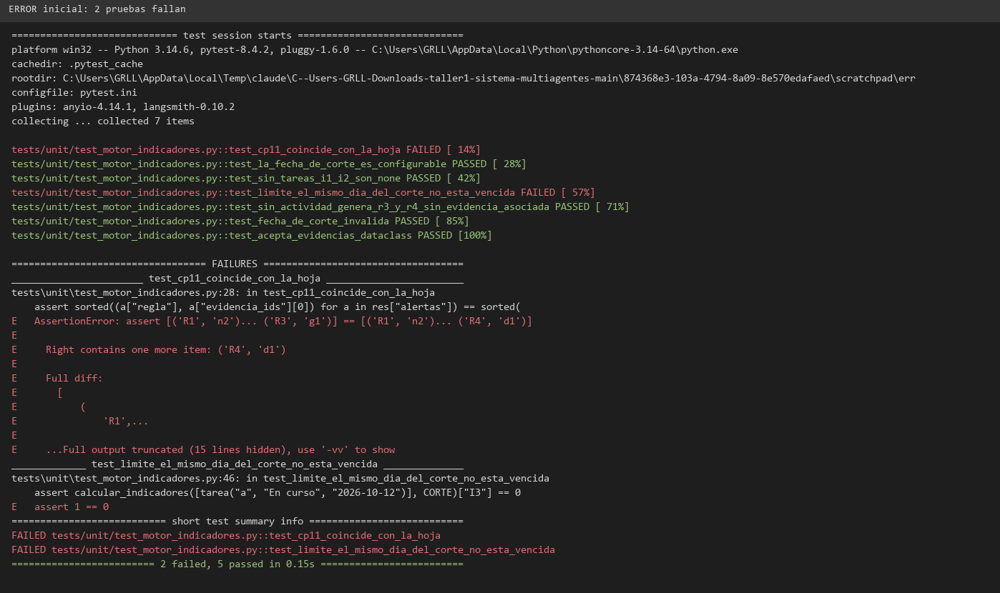
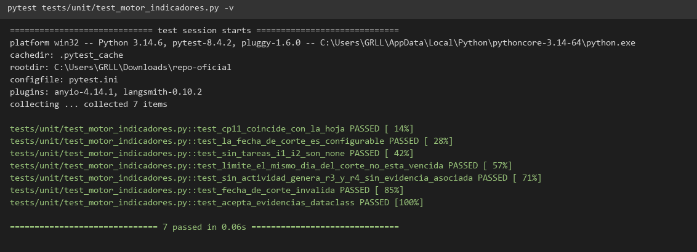
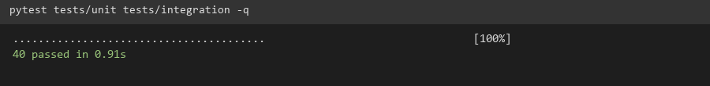
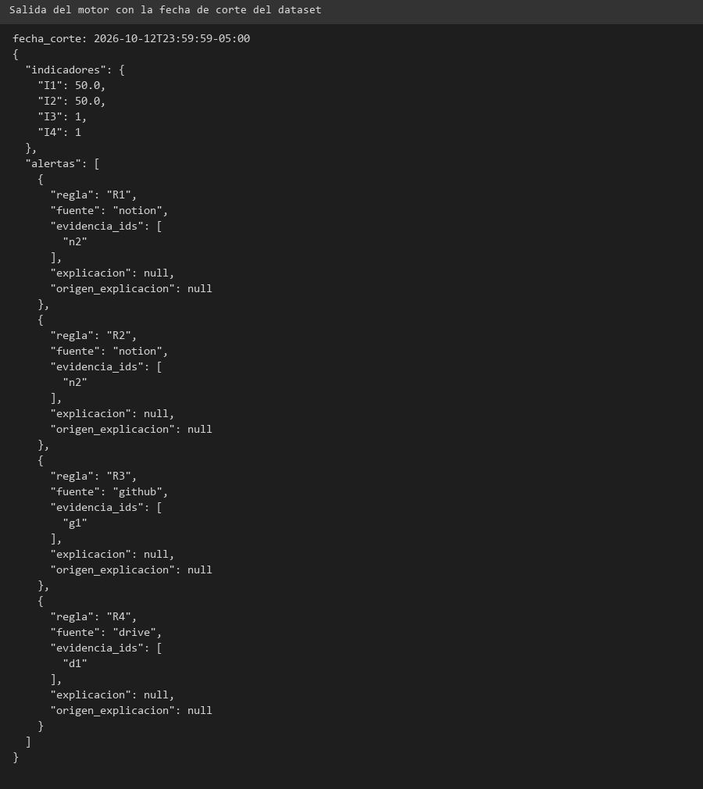

# TA-019 · Motor de indicadores I1–I4 y reglas R1–R4

## Objetivo

Calcular en Python, sin LLM, los 4 indicadores y evaluar las 4 reglas siempre
respecto de una **fecha de corte configurable**. Se programa contra el formato
de evidencias de TA-017, sin esperar al Agente Supervisor; TA-015 lo invoca al
integrarse.

## Implementación

- Código: `backend/app/modulos/supervision/motor_indicadores.py`
- Punto de entrada: `evaluar(evidencias, fecha_corte)` → `{"indicadores": {...}, "alertas": [...]}`
  (también `calcular_indicadores` y `evaluar_reglas` por separado).
- Acepta `Evidencia`/`EvidenciaNotion` o diccionarios. Ignora evidencias posteriores al corte.
- `fecha_corte` debe ser ISO 8601 con zona horaria; si no, lanza `ValueError`.
- Las alertas salen sin explicación (`explicacion=None`); la agrega TA-023.

### Definiciones

| Id | Definición |
|----|------------|
| I1 | % de tareas de Notion en estado `Listo` (None si no hay tareas) |
| I2 | % de tareas no `Listo` (`Sin empezar` + `En curso`) |
| I3 | Tareas no `Listo` con `fecha_limite` anterior al día del corte |
| I4 | Días enteros entre el corte y la evidencia más reciente de cualquier fuente (None si no hay actividad) |
| R1 | Tarea no completada con fecha límite anterior al corte |
| R2 | Tarea `En curso` sin ediciones durante más de 7 días |
| R3 | Repositorio sin commits en los 7 días previos al corte |
| R4 | Carpeta sin documentos modificados en los 14 días previos al corte |

Las alertas de R3/R4 se enlazan a la evidencia más reciente de esa fuente
(RN-003); si no existe ninguna, `evidencia_ids` queda vacío.

## Pruebas

`tests/unit/test_motor_indicadores.py` (7 pruebas) y dataset en
`tests/fixtures/ta017_dataset_ejemplo.json`.
`test_cp11_coincide_con_la_hoja` compara los valores calculados con los esperados
de la hoja (CP-11).

> **Pendiente:** el dataset incluido es de **ejemplo** (indicado en su campo `_nota`).
> Reemplazarlo por el export real de TA-017 y volver a ejecutar CP-11.

## Error encontrado y solución

Primera ejecución: **2 pruebas fallaron**.

1. **`test_limite_el_mismo_dia_del_corte_no_esta_vencida` (`assert 1 == 0`).**
   - Causa: la fecha límite (un día, p. ej. `2026-10-12`) se comparaba contra el
     corte convertido a UTC. El corte `2026-10-12T23:59:59-05:00` equivale a
     `2026-10-13T04:59:59Z`, y la tarea con vencimiento ese mismo día salía vencida.
   - Solución: `_dia_de_corte` toma el día calendario del corte **en su propia zona
     horaria** y `_vencida` compara día contra día (`dia < dia_corte`).
2. **`test_cp11_coincide_con_la_hoja` (faltaba la alerta `R4`).**
   - Causa: el dato de ejemplo del archivo de Drive tenía fecha `2026-10-05`, dentro
     de la ventana de 14 días del corte, por lo que R4 correctamente no se activaba.
     El error estaba en el valor esperado del dataset, no en el motor.
   - Solución: se cambió la fecha del documento a `2026-09-20` (fuera de ventana).

Tras ambas correcciones: **7 passed** y la suite completa **40 passed**.

## Evidencias

- `docs/sprint1/evidencias/TA-019_pytest.png`
- `docs/sprint1/evidencias/TA-019_pytest_suite.png`
- `docs/sprint1/evidencias/TA-019_error.png`
- `docs/sprint1/evidencias/TA-019_demo.png`
- `docs/sprint1/evidencias/TA-019_salida.json.txt`

## Criterios

1. Calcula I1–I4 y evalúa R1–R4 para la fecha de corte recibida, sin LLM: **cumplido**.
2. Con la fecha de TA-017, 100 % de coincidencia con la hoja (CP-11): **pendiente** de
   ejecutar con el dataset real.
