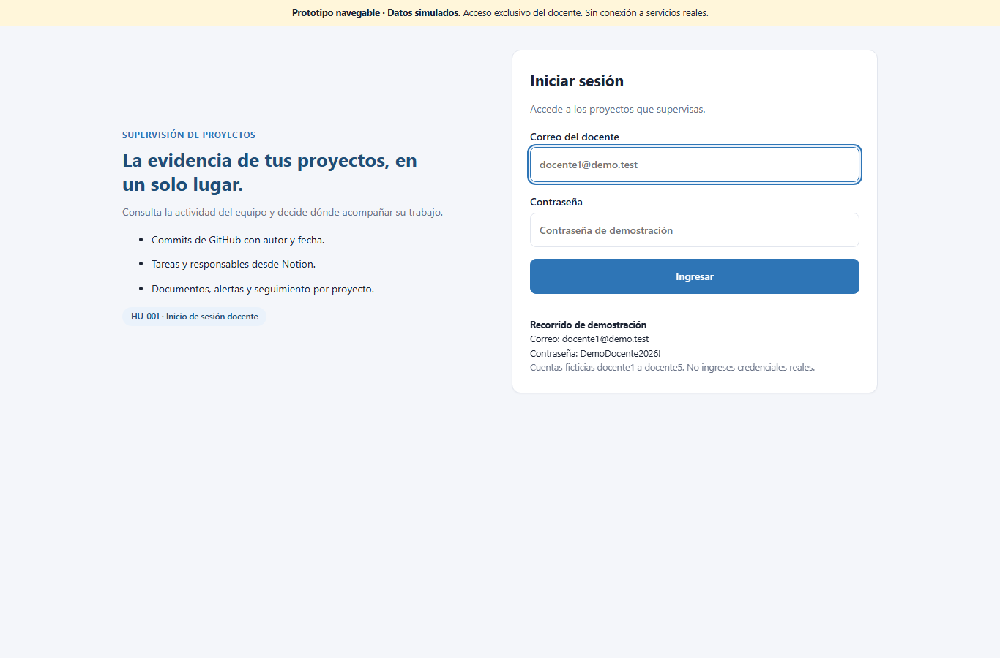
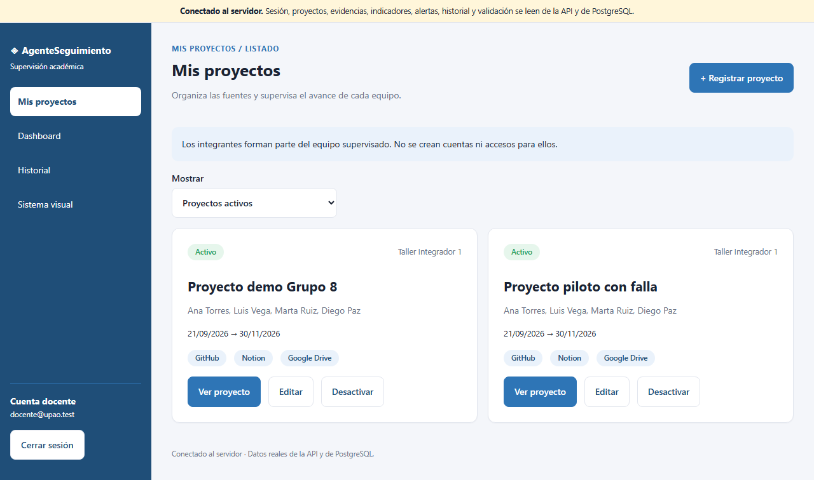
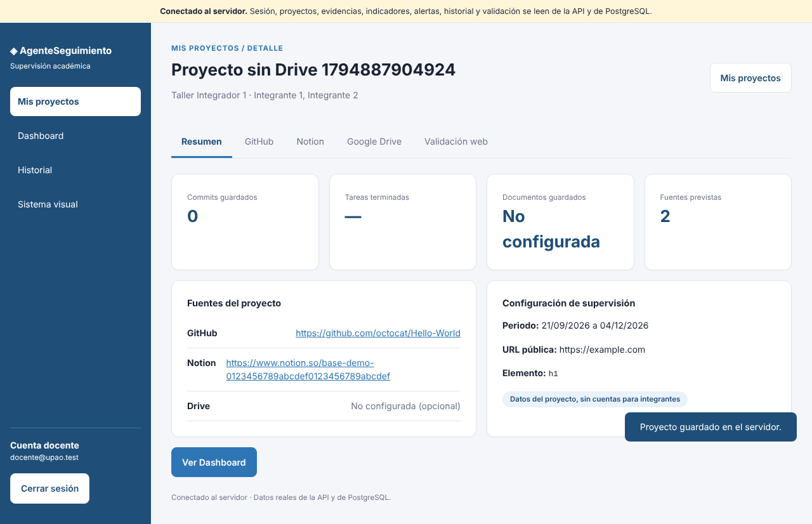
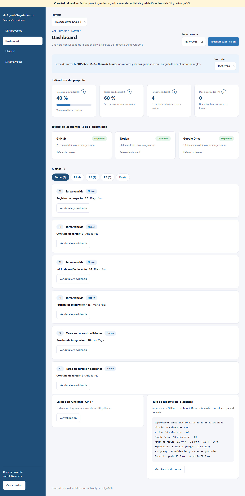
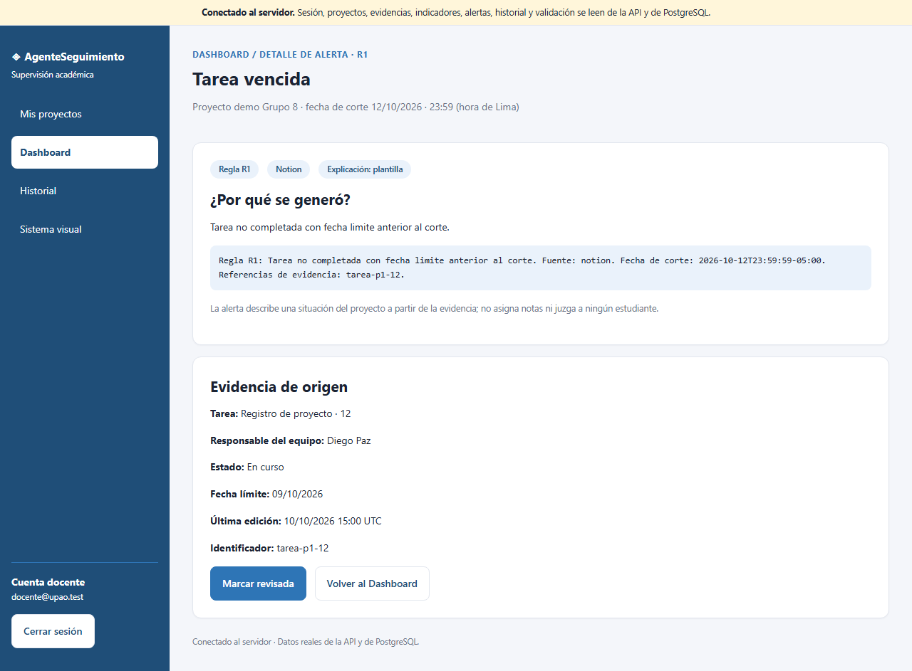
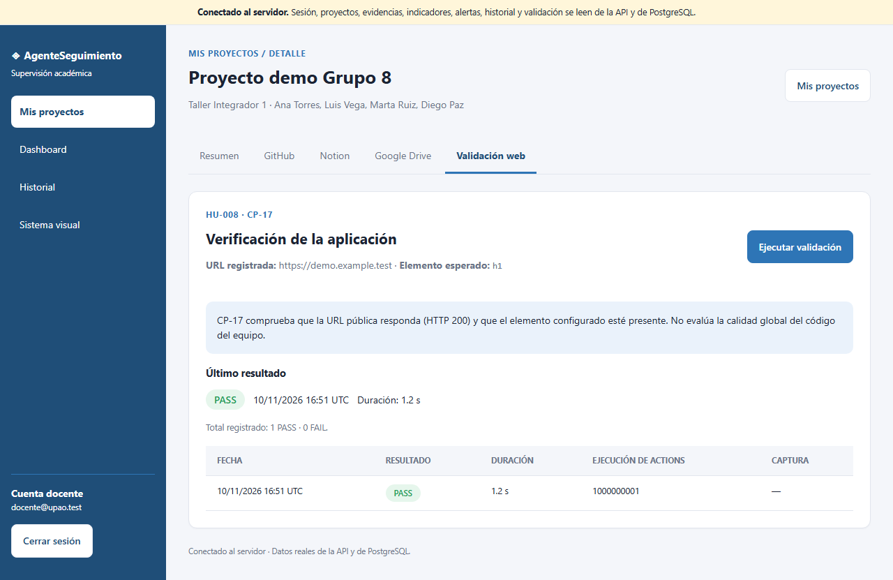
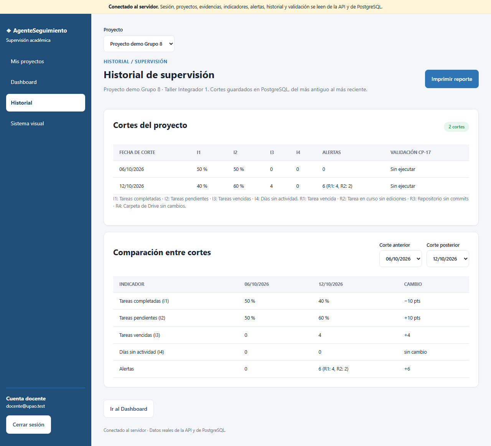

# Guía de uso para el docente

**Sistema:** AgenteSeguimiento · supervisión de proyectos de software académicos
**Grupo 8 · Taller Integrador 1 · DO-006 (Mondragón)**

Esta guía explica cómo usar el sistema para supervisar a sus grupos. No necesita
conocimientos técnicos: el sistema lee por usted GitHub, Notion y, si el grupo la usa,
una carpeta de Google Drive, y le muestra el avance, las alertas y su evidencia.

> Las capturas usan el proyecto de demostración del equipo; los nombres que aparecen son
> datos de ejemplo.

## 1. Antes de empezar

- Abra la dirección del sistema que le entregó el equipo (Chrome o Edge actualizados).
- La franja superior debe decir **«Conectado al servidor»**.
- Si es el primer acceso del día, el servidor gratuito puede tardar hasta **1 minuto** en
  despertar. Espere y vuelva a intentar; no es un error.
- Su contraseña se le entrega por un canal aparte. El sistema no la muestra mientras escribe.

## 2. Ingresar

1. Escriba su **correo del docente** y su **contraseña**.
2. Pulse **Ingresar**. Llegará a **Mis proyectos**.

Si los datos no coinciden, verá un mensaje de error sin indicar cuál de los dos falló
(por seguridad). Tras varios intentos fallidos el acceso se bloquea unos minutos.

## 3. Mis proyectos

Cada tarjeta es un proyecto que usted supervisa, con sus integrantes, su periodo y las
fuentes que tiene registradas.

| Botón | Qué hace |
|---|---|
| **+ Registrar proyecto** | Abre el formulario para un proyecto nuevo |
| **Ver proyecto** | Abre el detalle del proyecto |
| **Editar** | Cambia los datos o las fuentes |
| **Desactivar / Reactivar** | Oculta el proyecto sin borrarlo |

## 4. Registrar un proyecto

Complete las tres secciones del formulario y pulse **Guardar proyecto**.

1. **Datos del proyecto:** nombre, curso, fechas de inicio y fin, e integrantes separados por coma.
2. **Fuentes de evidencia:** pegue los enlaces tal como aparecen en el navegador.
    - **Repositorio de GitHub** (obligatorio).
    - **Base de tareas de Notion** (obligatorio).
    - **Carpeta de Google Drive (opcional).** Si el grupo no usa Drive, déjelo vacío: la
      fuente aparecerá como «No configurada» y no se evaluará la regla R4.
3. **Aplicación a verificar:** la URL pública de la aplicación del grupo y el elemento que
   debe aparecer en ella (por ejemplo `h1`).

Para que el sistema pueda leer las fuentes, el grupo debe darle acceso (repositorio
público o colaborador; base de Notion conectada; carpeta de Drive compartida como
Lector). El equipo técnico se lo indica a cada grupo.

## 5. Detalle del proyecto

| Pestaña | Qué muestra |
|---|---|
| **Resumen** | Totales de commits, tareas terminadas y documentos; enlaces de las fuentes |
| **GitHub** | Últimos commits: autor, fecha (UTC), mensaje |
| **Notion** | Tareas con responsable, estado y fecha límite |
| **Google Drive** | Documentos de la carpeta. Si el grupo no la registró, lo indica |
| **Validación web** | Resultado de la verificación de la aplicación (sección 8) |

Pulse **Ver Dashboard** para ver indicadores y alertas.

## 6. Dashboard: cómo va el proyecto

1. Elija la **Fecha de corte** (por defecto, hoy).
2. Pulse **Ejecutar supervisión**. Los agentes leen las fuentes, calculan los indicadores
   y guardan el corte. Tarda unos segundos (más si el servidor estaba dormido).
3. Con **Ver corte** puede volver a cualquier fecha ya guardada.

### Indicadores

Pase el ratón o pulse **?** en cada tarjeta para ver la fórmula.

| Indicador | Qué significa | Cómo leerlo |
|---|---|---|
| **I1 · Tareas completadas** | % de tareas en «Listo» | Más alto es mejor |
| **I2 · Tareas pendientes** | % de tareas sin empezar o en curso | Debe bajar al acercarse la entrega |
| **I3 · Tareas vencidas** | Tareas no terminadas con fecha límite pasada | Idealmente 0 |
| **I4 · Días sin actividad** | Días desde la última evidencia en cualquier fuente | Valores altos indican un grupo detenido |

### Estado de las fuentes

| Etiqueta | Significado |
|---|---|
| **Disponible** | Se leyó bien en esta ejecución |
| **Integración fallida** | No se pudo leer (permisos o servicio caído). El resto del corte sigue y esa fuente **no genera alertas** de inactividad |
| **No configurada** | El grupo no registró esa fuente (solo Drive puede faltar) |

## 7. Alertas y su evidencia

Las alertas las detecta un motor de reglas; la inteligencia artificial solo redacta la
explicación. Use los filtros **R1–R4** para ver una regla.

| Regla | Se genera cuando… | Fuente |
|---|---|---|
| **R1** · Tarea vencida | Una tarea no terminada pasó su fecha límite | Notion |
| **R2** · Tarea en curso sin ediciones | Una tarea «En curso» no se edita hace más de 7 días | Notion |
| **R3** · Repositorio sin commits | No hubo commits en los 7 días previos al corte | GitHub |
| **R4** · Carpeta sin cambios | No se modificó ningún documento en 14 días | Drive (solo si está registrada) |

Pulse **Ver detalle y evidencia** para ver la explicación, la evidencia que la respalda
(tarea, commit o documento) y su enlace. La explicación indica si la redactó Gemini o la
plantilla del sistema; el contenido de la alerta es el mismo en ambos casos.

> El sistema **no asigna notas**: las alertas son señales para que usted revise.

## 8. Validación funcional de la aplicación (CP-17)

En **Ver validación** (Dashboard) o en la pestaña **Validación web**:

1. Pulse **Ejecutar validación**. El sistema abre la URL pública del grupo y busca el
   elemento indicado.
2. Resultado: **PASS** (la aplicación responde y muestra el elemento) o **FAIL** (con una
   captura de lo que se vio). Un FAIL tarda unos 12 s; una validación completa puede tardar hasta 2 minutos.

Esta prueba solo comprueba que la aplicación está publicada y responde; no evalúa la
calidad global del código.

## 9. Historial y reporte imprimible

1. Desde el Dashboard, pulse **Ver historial de cortes**.
2. La tabla compara los indicadores y las alertas de cada fecha de corte.
3. Pulse **Imprimir reporte** para obtener una versión lista para imprimir o guardar como PDF.

## 10. Cerrar sesión

Pulse **Cerrar sesión** (abajo a la izquierda). Vuelve a la pantalla de ingreso.

## 11. Problemas frecuentes

| Situación | Qué hacer |
|---|---|
| La página tarda en cargar o dice que no se pudo conectar | El servidor gratuito está despertando: espere 1 minuto y vuelva a intentar |
| Una fuente aparece como «Integración fallida» | El grupo debe revisar el acceso (sección 4). El resto del corte es válido |
| Drive aparece como «No configurada» | Es correcto si el grupo no usa Drive. Para agregarla: **Editar** el proyecto |
| Las explicaciones dicen «plantilla» | Se agotó la cuota gratuita de Gemini; la alerta y su evidencia son las mismas |
| Quiere ver un día anterior | Elija la fecha en **Ver corte** o en el Historial |

Contacto técnico: Grupo 8 (Chávez: plataforma y fuentes · Reyes: agentes e indicadores ·
Mondragón: pantallas · Castro: acceso y validación).
