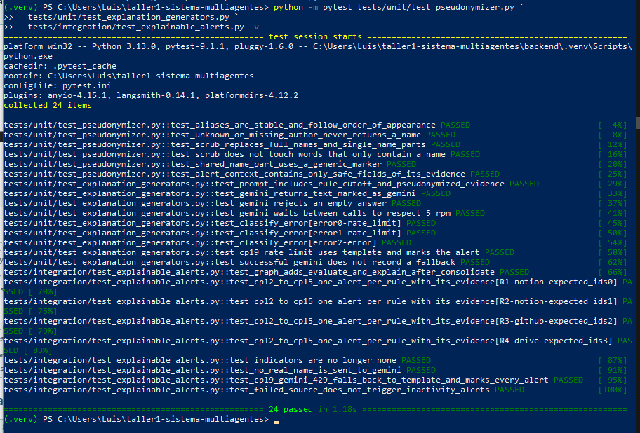
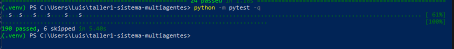
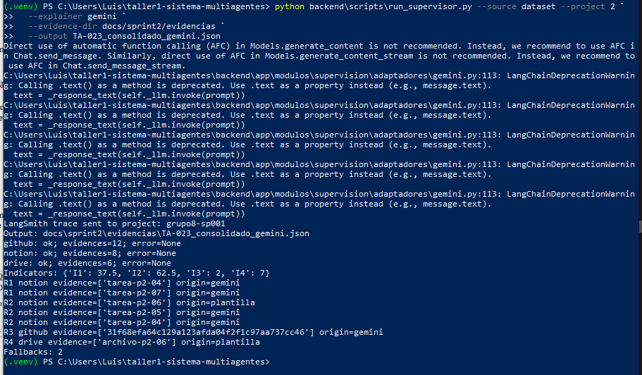
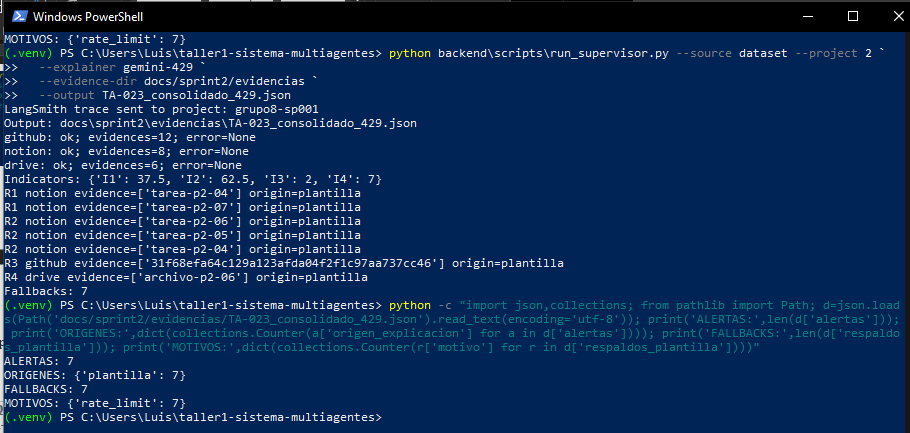
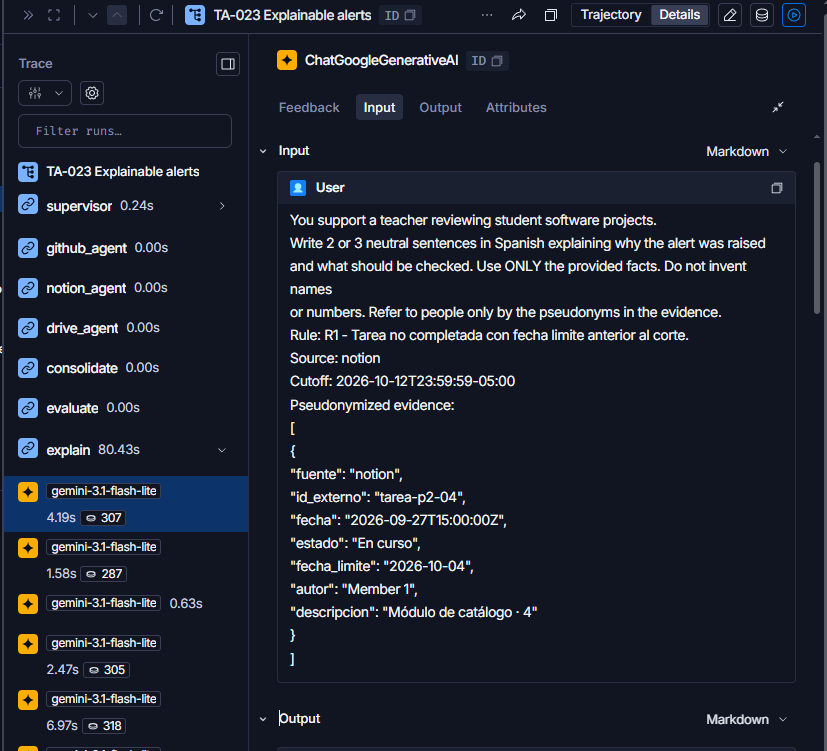
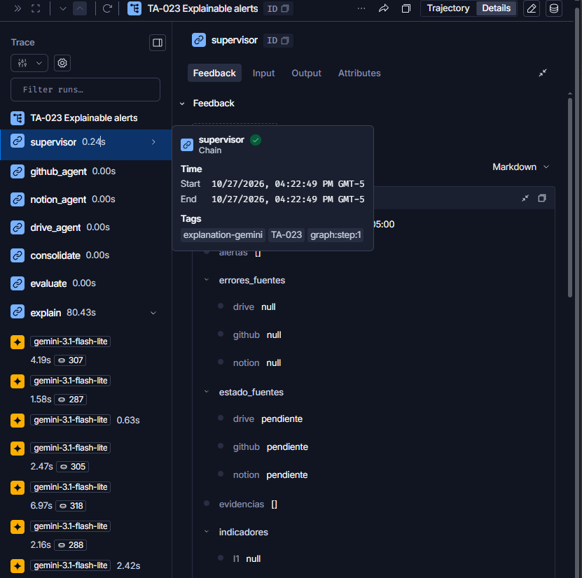

# TA-023 · Alertas explicables

**Responsable:** Reyes · **Sprint:** 2 · **Semana:** 9 · **Verificador:** Mondragón

## Resumen

El Agente Supervisor calcula los indicadores I1–I4 y detecta las alertas R1–R4 mediante el motor determinista `motor_indicadores.evaluar`. Posteriormente, seudonimiza las evidencias de los autores y genera explicaciones mediante Gemini o plantillas de respaldo.

Se mantienen los contratos compartidos en español para asegurar la compatibilidad con los módulos existentes. La integración fue validada mediante pruebas unitarias, pruebas de integración, ejecuciones controladas y trazas de LangSmith.

## Implementación

- **`evaluate`:** utiliza `motor_indicadores.evaluar` para calcular indicadores y detectar alertas sin depender de un modelo de lenguaje.
- **`explain`:** integra `Pseudonymizer` y `GeneradorExplicacion` para producir explicaciones a partir de evidencias protegidas.
- **`ResilientExplanationGenerator`:** activa plantillas de respaldo ante errores de Gemini, incluyendo HTTP 429.
- **`run_supervisor.py`:** admite `--source`, `--project`, `--explainer`, `--evidence-dir` y `--output`.
- **Gemini:** se utilizó el modelo `gemini-3.1-flash-lite`, configurado mediante la variable `GEMINI_MODEL`.
- **LangSmith:** las ejecuciones enviaron trazas al proyecto `grupo8-sp001`.

## Evidencias de aceptación

| Criterio | Archivo | Resultado observado |
|---|---|---|
| CP-12 a CP-15 | `evidencias/TA-023_consolidado_plantilla.json` | Se generaron 7 alertas: R1 (2), R2 (3), R3 (1) y R4 (1), con sus correspondientes IDs de evidencia. |
| Sin nombres reales en el prompt de Gemini | `evidencias/TA-023_langsmith_prompt.png` | Se verificó en LangSmith un prompt con el seudónimo `Member 1`, sin visualizar el nombre real del autor en la entrada inspeccionada. |
| CP-19: respaldo ante HTTP 429 | `evidencias/TA-023_consolidado_429.json` | La simulación generó 7 alertas con `origin=plantilla` y registró 7 fallbacks, sin consumir cuota real de Gemini. |
| Pruebas unitarias y de integración | `evidencias/TA-023_pytest.png` | 24 pruebas TA-023 aprobadas, incluyendo reglas R1–R4, seudonimización y respaldo. |
| Regresión completa | `evidencias/TA-023_pytest_total.png` | 190 pruebas aprobadas y 6 omitidas, sin regresiones detectadas. |
| Traza de nodos en LangSmith | `evidencias/TA-023_traza_langsmith.png` | Se observaron los nodos `consolidate`, `evaluate` y `explain`, junto con llamadas reales a Gemini. |

## Resultados de ejecución

### Escenario A: plantilla

**File:** `evidencias/TA-023_consolidado_plantilla.json`

- Evidencias procesadas: 26 (GitHub: 12; Notion: 8; Drive: 6).
- Indicadores: I1 = 37.5; I2 = 62.5; I3 = 2; I4 = 7.
- Alertas generadas: 7.
- Explicaciones mediante plantilla: 7.
- Fallbacks: 0.

**Resultado:** ejecución satisfactoria sin utilizar Gemini real.

### Escenario B: Gemini real

**File:** `evidencias/TA-023_consolidado_gemini.json`

Se corrigió la configuración del modelo tras detectar errores de generación con `gemini-3.8-flash` (HTTP 503) y `gemini-2.5-flash` (HTTP 404). El modelo `gemini-3.1-flash-lite` respondió satisfactoriamente.

Se observaron dos ejecuciones relevantes:

- Ejecución exitosa: 7 explicaciones con Gemini y 0 fallbacks.
- Ejecución posterior: 5 explicaciones con Gemini y 2 mediante plantilla, con 2 fallbacks.

El archivo JSON final corresponde a la ejecución posterior.

**Resultado:** integración real funcional, con respaldo automático ante fallos puntuales.

**Observación técnica:** se presentaron advertencias de AFC y deprecación del acceso a `.text()`. No impidieron completar las ejecuciones y quedan identificadas para mantenimiento posterior.

### Escenario C: HTTP 429 simulado

**File:** `evidencias/TA-023_consolidado_429.json`

- Alertas generadas: 7.
- Explicaciones mediante plantilla: 7.
- Fallbacks: 7.
- Solicitudes reales a Gemini: 0.

**Resultado:** el Supervisor mantuvo las siete alertas ante el error 429 simulado.

## Evidencias de ejecución

## Horas reales

Registrar únicamente el tiempo efectivamente trabajado en cada checkpoint.

| Checkpoint | Tiempo real (h) | Comentario |
|---|---:|---|
| CP1 | Pendiente | Verificación de la línea base y creación de rama. |
| CP2 | Pendiente | Elaboración de la especificación TA-023. |
| CP3 | Pendiente | Integración del nodo `evaluate`. |
| CP4 | Pendiente | Implementación y pruebas de seudonimización. |
| CP5 | Pendiente | Generadores Gemini y plantilla resiliente. |
| CP6 | Pendiente | Integración de `explain` y ejecución del Supervisor. |
| CP7 | Pendiente | Pruebas unitarias, integración y regresión. |
| CP8 | Pendiente | Ejecuciones, diagnóstico de Gemini, JSON y capturas de LangSmith. |
| CP9 | Pendiente | Documentación, PR y revisión formal. |

## PR y revisión

- **Rama:** `reyes/ta-023-explainable-alerts`.
- **PR:** #26, integrado en `main` el 27/10/2026 (commit `4a10f25`).
- **Verificador:** Mondragón.
- **Pruebas al integrar:** `190 passed, 6 skipped`.
- **Pruebas propias de TA-023:** `24 passed`.

### Requisitos de revisión

Antes del merge deben verificarse los criterios de aceptación, las evidencias de ejecución, la protección de nombres reales y los resultados de GitHub Actions.

El autor del PR no realizará el merge. Mondragón será responsable de revisar y aprobar la integración a `main`.