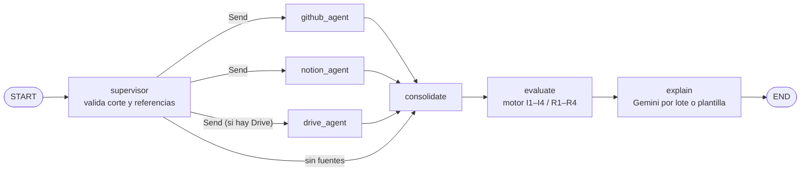
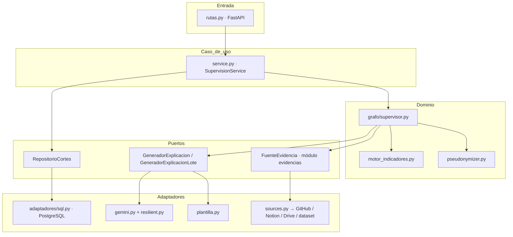
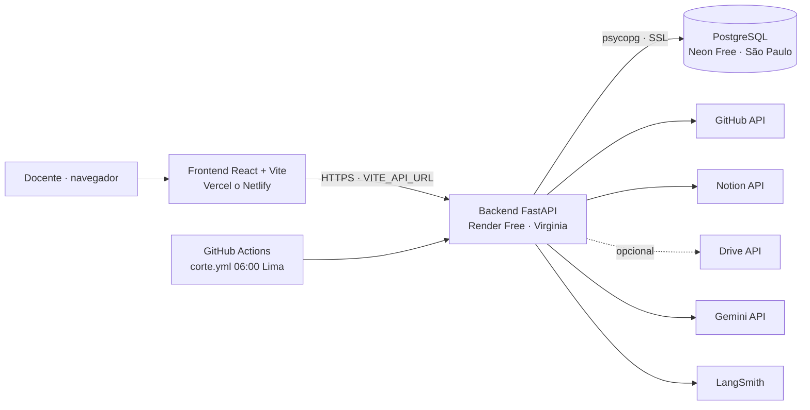

# Documentación técnica · Agentes inteligentes para el seguimiento de proyectos

Grupo 8 · Taller Integrador 1 · UPAO 2026-20

| Sección | PBI | Responsable |
|---|---|---|
| 1. Sistema multiagente | DO-005 | Reyes |
| 2. Integraciones y despliegue | DO-007 | Chávez |

Arquitectura general y reglas de dependencia: `docs/arquitectura.md`. Modelo de datos:
`docs/modelo-de-datos.md`. Contrato HTTP completo: `docs/api/openapi.json`.

---

## 1. Sistema multiagente (DO-005)

### 1.1 Qué hace

Para un proyecto y una **fecha de corte**, el sistema lee las evidencias de GitHub
(commits), Notion (tareas) y, si el proyecto la registró, Google Drive (documentos).
Con ellas calcula los indicadores I1–I4, detecta alertas R1–R4 y redacta una
explicación por alerta. El resultado se guarda como un corte en PostgreSQL.

Lo determinista (qué es una alerta y cuánto vale un indicador) lo decide un motor de
reglas en Python. El LLM (Gemini) solo **redacta** la explicación de alertas que el
motor ya detectó; si no está disponible, una plantilla la redacta.

### 1.2 Grafo de agentes (LangGraph)



| Nodo | Archivo | Responsabilidad |
|---|---|---|
| `supervisor` | `grafo/supervisor.py` (bloque F) | Valida la fecha de corte (ISO 8601 con zona). Marca `fallo` las fuentes obligatorias sin adaptador o sin referencia y `no_configurada` a Drive si el proyecto no la registró |
| `github_agent`, `notion_agent`, `drive_agent` | bloque H | Corren en paralelo con `Send`. Piden evidencias a su adaptador con reintento y tiempo máximo (TA-030), descartan las posteriores al corte y escriben su estado. Un fallo no detiene a los demás (RN-002) |
| `consolidate` | bloque I | Une las evidencias sin duplicados (`fuente` + `id_externo`) y las ordena por fecha |
| `evaluate` | bloque I2 → `motor_indicadores.py` | Calcula I1–I4 y R1–R5. Descarta las alertas de fuentes en `fallo` o `no_configurada`: la falta de datos no prueba inactividad |
| `explain` | bloque I3 → `explicacion.py` | Seudonimiza y pide **todas** las explicaciones del corte en una sola solicitud a Gemini (TA-046). Si falla, la plantilla explica todas |

El estado del grafo (`SupervisorState`) usa reductores para que los agentes escriban en
paralelo: `merge_dicts` para estados, errores y detalles por fuente, y `operator.add`
para la lista de evidencias.

### 1.3 Indicadores y reglas

| Id | Definición | Fuente |
|---|---|---|
| I1 | Tareas `Listo` ÷ total × 100 | Notion |
| I2 | Tareas `Sin empezar` o `En curso` ÷ total × 100 | Notion |
| I3 | Tareas no `Listo` con fecha límite anterior al día de corte | Notion |
| I4 | Días entre la última evidencia y el corte | Fuentes registradas |
| R1 | Tarea no completada con fecha límite vencida | Notion |
| R2 | Tarea `En curso` sin ediciones en más de 7 días | Notion |
| R3 | Repositorio sin commits en los 7 días previos al corte | GitHub |
| R4 | Carpeta sin documentos modificados en los 14 días previos | Drive |
| R5 | Commit de los 7 días previos cuyo mensaje no coincide con los archivos que cambió | GitHub |

Toda alerta lleva el `id_externo` de la evidencia que la respalda (RN-003). El
repositorio no guarda una alerta sin evidencia; el checklist
`backend/scripts/verificar_trazabilidad.py` lo comprueba contra la base.

### 1.3.1 R5 · Coherencia entre commit y código

Pedida por el docente para detectar commits cuyo mensaje no corresponde a lo que
subieron. `supervision/coherencia.py` compara el mensaje con los **nombres de los
archivos y las líneas cambiadas** (el agente de GitHub los lee con
`GET /repos/{org}/{repo}/commits/{sha}`). No lee el código ni pregunta a un LLM:

| Caso | Ejemplo |
|---|---|
| El commit no cambia el contenido de ningún archivo | «feat: historial completo» vacío |
| Dice haber escrito pruebas y no tocó nada de pruebas | «test: pruebas del login» que solo cambia `README.md` |
| Anuncia código (`feat`, `fix`, «implementa»…) y solo cambió documentación o imágenes | «feat: agente Drive» con solo `.md` y `.png` |
| Nombra un archivo que no modificó | «fix: corrige Login.jsx» que cambia `Proyectos.jsx` |

No se evalúan los merges ni los commits sin detalle. El **motivo** calculado siempre
aparece en la explicación (lo redacte Gemini o la plantilla) y a Gemini va sin nombres
reales. La alerta dice «posible incoherencia»: no prueba que el estudiante mintió, y el
docente la revisa con el botón que abre el commit. Sobre el historial del propio
repositorio (236 commits) marcó 3, los tres incoherencias reales.
`GITHUB_DETALLE_COMMITS=0` la apaga si la cuota de GitHub se ajusta.

### 1.4 Fuentes obligatorias y opcionales

GitHub y Notion son obligatorias; **Drive es opcional** (semana 12). Si el proyecto no
registró carpeta:

- el Supervisor no despacha al agente Drive y la marca `no_configurada` (sin error);
- no se evalúa R4 y no aparece en «X de Y fuentes disponibles» del Dashboard;
- I1–I3 no cambian (salen de Notion) e I4 usa la última evidencia de GitHub y Notion.

Prueba: `tests/integration/test_drive_opcional.py` y CP-API6 en
`frontend/e2e-api/conectado.spec.js`.

### 1.5 Explicaciones con Gemini

| Aspecto | Implementación |
|---|---|
| Modelo | `GEMINI_MODEL` (en el piloto, `gemini-3.1-flash-lite`) por `langchain-google-genai` |
| Una solicitud por corte | `generar_lote` envía todas las alertas y pide un arreglo JSON con exactamente N textos (TA-046) |
| Ritmo | Espera mínima de 13 s entre solicitudes del mismo proceso |
| Privacidad | `pseudonymizer.py` cambia autores por `Member N`, recorta descripciones y verifica el prompt final |
| Respaldo | `ResilientExplanationGenerator`: ante 429, error o respuesta mal formada, la plantilla explica **todas** las alertas; el origen queda en `origen_explicacion` |
| Razonamiento | `GEMINI_THINKING_BUDGET` / `GEMINI_REASONING_EFFORT` solo si se definen |

### 1.6 Estabilidad con fuentes reales (TA-030)

`supervision/estabilidad.py` envuelve la llamada de cada agente:

| Situación | Comportamiento |
|---|---|
| Error transitorio (HTTP 5xx, 429, error de red, tiempo agotado del cliente) | Se reintenta (`SUPERVISION_SOURCE_ATTEMPTS`, por defecto 2) tras `SUPERVISION_RETRY_BACKOFF_S` × intento (2 s) |
| Error permanente (credenciales, permisos, referencia inválida) | No se reintenta: la fuente queda en `fallo` con el mensaje |
| Fuente que no responde | A los `SUPERVISION_SOURCE_TIMEOUT_S` (90 s; 60 s en `render.yaml`) queda en `fallo` y el corte sigue |
| Medición | El consolidado incluye `estabilidad`: intentos y duración (ms) de cada agente |
| Guardados simultáneos (corte.yml y el docente) | El repositorio borra y vuelve a insertar las alertas del día en una transacción; la prueba `test_dos_guardados_simultaneos_no_duplican_alertas` comprueba que no se duplican |

Evidencia: `python backend/scripts/ta030_tres_ejecuciones.py --github … --notion … [--drive …]`
corre 3 cortes con trazas `TA-030` en LangSmith y escribe
`docs/sprint2/evidencias/TA-030_ejecuciones.json` y `.md`.

### 1.7 Arquitectura hexagonal del módulo



El caso de uso solo conoce puertos. `sources.py` decide por variables de entorno si las
fuentes son reales (`SUPERVISION_SOURCES=real`) o el dataset controlado de TA-017
(`dataset`), y si el explicador es Gemini o la plantilla (`SUPERVISION_EXPLAINER`).

### 1.8 API de supervisión

| Ruta | Respuesta (`contrato.py`) | Uso |
|---|---|---|
| `POST /proyectos/{id}/consolidacion` | `ConsolidacionOut` | Ejecuta el grafo y guarda el corte (botón «Ejecutar supervisión» y `corte.yml`) |
| `GET /proyectos/{id}/indicadores?fecha_corte=AAAA-MM-DD` | `IndicadoresCorteOut` | I1–I4 y estado de las fuentes |
| `GET /proyectos/{id}/alertas?fecha_corte=AAAA-MM-DD` | `AlertasCorteOut` | Alertas con su evidencia de origen |
| `GET /proyectos/{id}/historial` | `HistorialOut` | Todos los cortes con I1–I4, alertas por regla y CP-17 del día |

Todas exigen JWT y devuelven 404 si el proyecto es de otro docente. Un corte es único por
proyecto y día en hora de Lima; repetirlo el mismo día lo reemplaza.

### 1.9 Trazas y pruebas

- LangSmith: proyecto `LANGSMITH_PROJECT` (`grupo8-sp001`). Cada corte es una traza con
  los nodos del grafo; los scripts de evidencia usan tags por PBI (`TA-022`, `TA-030`, `TA-036`).
- Pruebas del núcleo: `tests/unit/test_supervisor_unit.py`, `test_motor_reglas.py`,
  `test_pseudonymizer.py`, `test_ta046_gemini_por_lote.py`, `test_ta030_estabilidad.py`,
  `tests/integration/test_supervisor_graph.py`, `test_ta018_cutoff_history.py`,
  `test_ta022_supervision_api.py`, `test_drive_opcional.py`.

```powershell
python -m pytest -q                              # sin base: las de PostgreSQL se omiten
$env:DATABASE_URL="postgresql+psycopg://..."; python -m pytest -q   # suite completa
```

---

## 2. Integraciones y despliegue (DO-007)

### 2.1 Integraciones externas

| Fuente | Cliente | Credencial | Qué se lee | Fallo controlado |
|---|---|---|---|---|
| GitHub REST | `evidencias/adaptadores/github/cliente.py` | `GITHUB_TOKEN` (fine-grained, solo lectura) | Commits de la rama principal | `GitHubError` / `RateLimitError`; 403 de límite se informa sin reintentar |
| Notion API (2025-09-03) | `adaptadores/notion/cliente.py` | `NOTION_TOKEN` o `NOTION_TOKENS` (`{"id de base": "token"}` para bases de otros equipos) | Tareas: Tarea, Responsable, Estado, Fecha límite | `NotionAuthError` (401/403) y `NotionError` |
| Google Drive v3 | `adaptadores/drive/cliente.py` | `GOOGLE_SERVICE_ACCOUNT_JSON` (cuenta de servicio, `drive.readonly`) | Archivos de la carpeta y subcarpetas (hasta 3 niveles) | `DriveError`. **Opcional** por proyecto |

Las referencias se registran como enlaces del navegador; `evidencias/referencias.py`
extrae `org/repo`, el id de la base de Notion y el de la carpeta. Qué debe permitir cada
equipo: `docs/sprint2/Conectar_fuentes_de_otro_equipo.md`.

Antes de registrar un proyecto piloto, sus fuentes se comprueban con los mismos
adaptadores del Supervisor:

```powershell
python backend/scripts/ta029_verificar_fuentes.py --proyecto "Grupo A" --github <url> --notion <url> [--drive <url>]
```

### 2.2 Despliegue gratuito



| Pieza | Servicio | Configuración en el repo |
|---|---|---|
| Base de datos | Neon Free (São Paulo) | `DATABASE_URL` con prefijo `postgresql+psycopg://` y `sslmode=require`; migraciones con `alembic upgrade head` desde una PC |
| Backend | Render Free | `render.yaml` (Blueprint): `rootDir: backend`, `pip install -r requirements-agentes.txt`, `uvicorn app.main:app --host 0.0.0.0 --port $PORT` |
| Frontend | Vercel (o Netlify) | `frontend/vercel.json` (o `frontend/netlify.toml`): build `npm run build`, salida `dist`, todas las rutas a `index.html`. Variable `VITE_API_URL` con la URL de Render |
| Corte diario | GitHub Actions | `.github/workflows/corte.yml`; secretos en *Settings → Secrets and variables → Actions* |
| E2E contra producción | GitHub Actions | `.github/workflows/e2e-produccion.yml` (a mano, con la URL del frontend) |

Pasos detallados con capturas: guía «Despliegue en Render y Neon» del equipo. Puntos que
causan errores conocidos:

- `DATABASE_URL` sin `+psycopg` hace que SQLAlchemy busque psycopg2 (no instalado) y el login da 500.
- `CORS_ORIGINS` debe tener la URL exacta del frontend, sin barra final.
- No se configura *Health Check Path* en Render: `/health` tiene límite de 5 peticiones por minuto.
- Render Free duerme tras unos 15 minutos sin tráfico; el primer acceso tarda. El frontend
  avisa «puede estar despertando» y `ejecutar_corte.py` espera hasta 90 s.

### 2.3 Variables de entorno del backend

| Variable | Obligatoria | Uso |
|---|---|---|
| `DATABASE_URL` | Sí | PostgreSQL (Neon) |
| `JWT_SECRET` | Sí | Firma de sesiones (HU-001) |
| `CORS_ORIGINS` | Sí en producción | URL del frontend |
| `SUPERVISION_SOURCES` | Sí | `real` en producción, `dataset` en pruebas |
| `SUPERVISION_EXPLAINER` | No | `gemini` o `template` (por defecto) |
| `GEMINI_API_KEY`, `GEMINI_MODEL` | Con Gemini | Explicaciones |
| `GITHUB_TOKEN`, `NOTION_TOKEN` / `NOTION_TOKENS` | Sí con fuentes reales | Lectura de evidencias |
| `GOOGLE_SERVICE_ACCOUNT_JSON` | Solo si algún proyecto usa Drive | Lectura de carpetas |
| `LANGSMITH_API_KEY`, `LANGSMITH_TRACING`, `LANGSMITH_PROJECT` | No | Trazas |
| `SUPERVISION_SOURCE_ATTEMPTS`, `SUPERVISION_RETRY_BACKOFF_S`, `SUPERVISION_SOURCE_TIMEOUT_S` | No | Estabilidad (TA-030) |

Ningún valor real se sube al repositorio (RN-001): `.env` está en `.gitignore` y
`gitleaks` corre en el CI.

### 2.4 Comprobación del despliegue (TA-025)

```powershell
# Arranque en frío: tras 20 min sin abrir la API
python backend/scripts/ta025_medir_arranque.py --url https://<servicio>.onrender.com --correo <docente> --clave <clave>
```

Escribe `docs/sprint2/evidencias/TA-025_arranque.json` y `.md`. Luego, en *Actions →
E2E contra produccion → Run workflow*, con la URL del frontend y `CP-API1|CP-API2|CP-API3|CP-API4|CP-API5|CP-API6`
como casos; el artefacto `reporte-e2e-produccion` es la evidencia del reporte Playwright.
